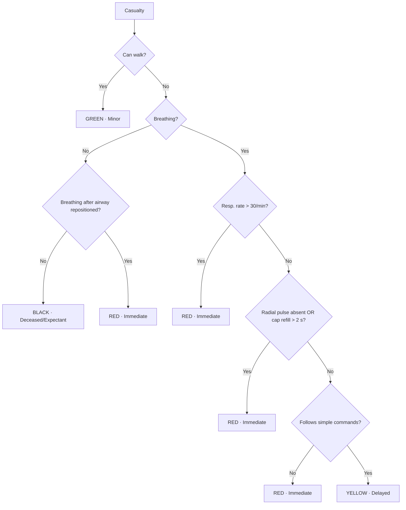

# MCI Triage Trainer

A simulation-based trainer for practising **mass-casualty incident (MCI) triage** with the **START** (Simple Triage and Rapid Treatment) protocol. Learners assess 10 virtual casualties under time pressure and assign a triage category to each. Every decision is scored against a deterministic reference classification.

> Course project: *Simulation & Virtual Reality in Medicine* · Status: `TODO: e.g. MVP in development` · Platform: `TODO: Unity / web`

---

## 1. Need & intended change

| | |
|---|---|
| **Problem** | MCIs are too rare for responders to learn triage on the job. Lectures and tabletop exercises lack realism. Live drills are realistic but costly and rarely repeated (Mills et al., 2019). |
| **Target users** | `TODO: e.g. medical / paramedicine students before their first live MCI drill` |
| **Current practice** | `TODO: how triage is taught to this group today` |
| **Desired measurable change** | Higher triage accuracy, lower under- and over-triage, and faster decisions compared with `TODO: comparator, e.g. lecture-only / card-based exercise` |

**Positioning:** the trainer is a repeatable preparation step **before** live drills. It does not replace them.

---

## 2. START reference algorithm
The scoring engine applies these rules in a fixed order. The same input always gives the same category.



| Category | Meaning |
|---|---|
| 🟢 GREEN | Minor: walking wounded |
| 🟡 YELLOW | Delayed: serious but stable |
| 🔴 RED | Immediate: life-threatening, salvageable |
| ⚫ BLACK | Deceased / expectant |

---

## 3. Scope

**MVP (in scope)**
- [ ] 1 scenario with 10 casualties defined in data files, not hard-coded
- [ ] Assessment through simple click-to-check actions (walk, breathing, RR, pulse/cap refill, commands)
- [ ] Timed decisions with a per-casualty timer and a scenario timer
- [ ] Deterministic START scoring with immediate or end-of-scenario feedback
- [ ] Session log export for evaluation (anonymised)

**Out of scope / possible extensions**
- AI-driven casualty dialogue. Removed: Mills et al. (2019) achieved effective triage with simple click-to-assess interactions.
- Realistic 3D assets and video, multiple scenarios, multiplayer, HMD support

Scope changes are logged in [`docs/scope-changes.md`](docs/scope-changes.md).

---

## 4. Evaluation plan

| Measure | Definition | Source |
|---|---|---|
| Triage accuracy | % of casualties assigned the reference category | Session log |
| Under-triage rate | % assigned a *lower* priority than the reference | Session log |
| Over-triage rate | % assigned a *higher* priority than the reference | Session log |
| Decision time | Seconds per casualty and per scenario | Session log |
| Protocol adherence | Required checks done in START order before a decision | Session log |
| Error patterns | Which START step is most often missed | Session log analysis |
| Workload | NASA-TLX | Questionnaire |
| Usability | `TODO: e.g. SUS` | Questionnaire |

**Study design:** `TODO: comparator, participants, procedure`
**Ethics / approval:** `TODO: reference the approved evaluation procedure`. Only approved procedures are used.

---

## 5. Traceability

Each requirement links to its design decision, implementation and test. Full matrix: [`docs/traceability.md`](docs/traceability.md).

| Req ID | Requirement | Evidence / rationale | Implementation | Test |
|---|---|---|---|---|
| R-01 | Classify each casualty per START | START protocol | `TODO: path/to/scoring` | `TODO: test id` |
| R-02 | Record decision time per casualty | Timeliness as an outcome (Mills et al., 2019) | `TODO` | `TODO` |
| R-03 | Compute under- and over-triage | Clinical cost of each error type | `TODO` | `TODO` |
| R-04 | Click-to-assess interaction, no free dialogue | Mills et al. (2019) | `TODO` | `TODO` |

---

## 6. Repository structure

```
.
├── src/                # application source (TODO: Unity Assets/ or web src/)
│   ├── scoring/        # deterministic START engine
│   ├── scenarios/      # casualty definitions (JSON)
│   └── ui/
├── tests/              # unit tests: every START branch + edge cases
├── docs/
│   ├── traceability.md
│   ├── scope-changes.md
│   ├── limitations-risks.md
│   ├── design-brief.pdf
│   └── meeting-notes/
├── evaluation/         # protocol, questionnaires, analysis scripts (no raw personal data)
└── README.md
```

---

## 7. Getting started

```bash
git clone TODO: repo-url
cd TODO: repo-name
# TODO: install / build / run steps for the chosen platform
# TODO: command to run tests
```

**Requirements:** `TODO: e.g. Unity 6000.3.25f1 LTS

---

## 8. Testing

- Unit tests cover **every branch** of the START flowchart, including boundary values: RR = 30 vs 31, cap refill = 2 s vs > 2 s.
- Scenario files are validated so every casualty has exactly one reference category.
- Known defects are tracked in Issues with the `defect` label.

---

## 9. Data handling

- No personal data is stored in this repository.
- Participants get pseudonymous IDs. The ID key is stored separately, offline, by `TODO: responsible member`.
- Raw evaluation data stays out of version control (`.gitignore`). Only aggregated results are committed.

---

## 10. Limitations & risks

See [`docs/limitations-risks.md`](docs/limitations-risks.md). Key items so far:
- Performance in a simulation does not prove transfer to real incidents or long-term retention.
- A screen- or card-based scene has lower physical and emotional realism than a live drill.
- Small samples can show "no detectable difference" but cannot prove equivalence.

---

## 11. Team & contributions

| Member | Role | Main contributions |
|---|---|---|
| TODO | | |
| TODO | | |
| TODO | | |

Individual contributions can be checked in the commit history and the linked Issues/PRs.

## References

- Mills, B., Dykstra, P., Hansen, S., et al. (2019). Virtual reality triage training can provide comparable simulation efficacy for paramedicine students compared to live simulation-based scenarios. *Prehospital Emergency Care.* `TODO: verify year (2019 online / 2020 issue) and add DOI`
- `TODO: START protocol source`
